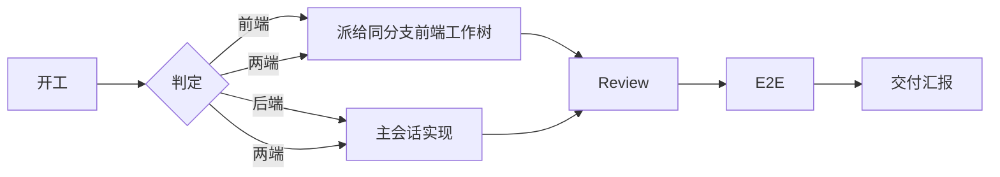

<div align="center">

# Sumer

**前后端工作树协作的分派与验收 skill**

[](https://claude.com/claude-code)
[](#)
[](#工作流)

在后端工作树做指挥，把前端交给同分支的前端工作树；review 由独立 subagent 执行；E2E 用 ego-lite 点一遍。

</div>

---

## 为什么用 Sumer

多工作树并行开发时，最容易出问题的不是写代码，而是流程：

- 前端派给了错误的分支或工作树。
- review 只看后端，或者把规范违规降级成“建议”。
- 修完 P0 后，最初的问题在汇报里消失了。
- 服务已经在跑，却因为“需要授权”又停一遍、起一遍。

Sumer 把这些固化成可重复的流程。

## 核心能力

| 能力 | 做法 |
|---|---|
| 角色判定 | 按工作树内容和消息来源判定，不依赖仓库名 |
| 前端派发 | 只派给分支与后端相同的前端工作树；先只读握手核对 |
| 并行开发 | 用户明确要求时才开 agentteam，按文件所有权拆分 |
| 独立 review | 独立只读 subagent；有前端改动必须做前端 review |
| P0 口径 | 崩溃、数据、权限、契约、费用，以及违反 `AGENTS.md` / `docs/` 明确约束 |
| E2E | 固定 18001 / 15173；同分支服务已跑直接复用 |
| 汇报 | 三节简报；原始问题保留，修复后也不删除 |

## 工作流



## 安装

Claude Code 用户级 skill 目录：

```bash
git clone https://github.com/Kasuza-Haruki/Sumer.git ~/.claude/skills/Sumer
```

Windows PowerShell：

```powershell
git clone https://github.com/Kasuza-Haruki/Sumer.git "$env:USERPROFILE\.claude\skills\Sumer"
```

也可以手动把 `SKILL.md`、`references/`、`assets/` 放到 `~/.claude/skills/Sumer/`。

## 使用

**自动加载**：收到 `[dispatch:` 消息、涉及前端改动、要 review 或 E2E 时，agent 会加载本 skill。

**手动调用**：

```text
/Sumer
```

确认已加载：在 Claude Code 输入 `/skills`，列表里能看到 `Sumer`。

## 派活格式

```text
[dispatch:<branch>]
任务：...
验收：...
非目标：...
契约：<涉及接口时给路径、入参、响应字段、错误格式>
必读：先加载 Sumer skill，按执行方规则执行；AGENTS.md；docs/ 设计规范与本任务相关文档
约束：复用现有组件和 Token；规范不确定时提问，不自行加样式；不改无关文件；不 commit/push；Review 由指挥方统一做
回报：以 [fe-report] 开头，给分支、改动文件、git diff --stat、验证命令与结果、阻塞
```

## Review 口径

有前端改动时，review 必须包含前端清单：

1. 是否遵守 `AGENTS.md` 和 `docs/` 设计规范。
2. 是否复用现有组件和 Token，有没有自造样式或新增未约定值。
3. 规范缺失、冲突或不确定时，是否向用户提出，有没有自行决定。

违反任一项即为 P0。只报 P0、只修 P0、只跑一轮；P1+ 只报告。

## E2E

- 固定：后端 `18001`，前端 `15173`。
- 服务已在跑且两端分支相同：直接复用，不授权。
- 需要自己启动或连库：先授权。
- 只复用本分支的服务；其他分支报告冲突，不换端口、不停别人的进程。

## 汇报

三节：结论、Review 问题、未验证与阻塞。

Review 问题保留原始描述、状态、修复与验证。已修的 P0 也不删除，避免最初的问题在汇报里消失。

## 目录

```text
Sumer/
├── SKILL.md
├── references/
│   ├── frontend-dispatch.md
│   ├── review.md
│   ├── e2e.md
│   └── report.md
├── assets/
│   └── handoff-template.md
└── evals/
    └── evals.json
```

`references/` 和 `assets/` 按需加载；`evals/` 只用于测试，不进入模型上下文。

## 适用场景

- 前后端分仓，用同名分支或同名工作树并行开发。
- 后端会话做指挥方，前端在独立会话或 worktree 中执行。
- 需要固定 review 和 E2E 口径的团队工作流。

## 不适用

- 纯问答、只读排查、状态查询。
- 没有前端配对仓库的单端项目。
