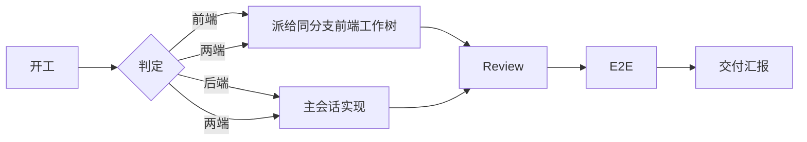

<div align="center">

# Sumer

**多版本并行开发的分派、验收与自验证 skill**

[](https://claude.com/claude-code)
[](#当前状态)
[](#工作流)

Sumer 是我给自己写的一套多版本并行开发流程。

后端工作树做指挥，前端交给同分支的前端工作树；review 交给独立 subagent；E2E 用 ego-lite 真点一遍。

它不是“AI 全自动写代码”，而是把 human in the loop 里最耗神的重复验证拿掉，让我能同时盯线上、提测、开发三个版本。

</div>

---

## 我为什么写这个

我平时一个人要同时处理三类事：

| 场景 | 例子 | 我最怕什么 |
|---|---|---|
| 线上问题 / 技术支持 | 线上 v0.7.0 的 bug 排查 | 改出新的线上问题 |
| 提测版本产品验收 | v0.7.1 的验收问题 | 改动不可控、回归不了 |
| 开发分支需求 | v0.7.2 的新需求 | 被前两个版本打断，进度一直拖 |

三个版本一起跑，最烦的不是写代码，是这些流程问题：

- **context 串了**：前后端代码、规范、状态混在一个会话里，模型越聊越糊涂。
- **前端派错 worktree**：派给了错误的分支，改完才发现不是同一个版本。
- **review 只看后端**：前端组件、Token、视觉规范没人看，最后靠人眼兜底。
- **修完 P0 原始问题消失**：汇报里只剩“已修复”，最初的问题没人记得。
- **服务重复启动**：明明已经在跑，又因为“需要授权”停一遍、起一遍。
- **单测过了界面点不动**：代码逻辑通，不等于功能真的可用。

所以我把这套流程写成了 Sumer。它不解决“怎么写出好代码”，它解决“多个版本并行时，怎么别乱”。

## 这套东西怎么想

### 1. 版本隔离：一个版本一个 worktree

用 `git worktree` + `orca` 并行处理多个分支。

线上问题一个 worktree，提测验收一个 worktree，开发需求一个 worktree。每个 worktree 有自己的分支、会话和验证环境，互不覆盖。

### 2. context 隔离：前端别进后端会话

一项需求涉及前后端时，把前端拆出去，保证前端内容不进入后端会话。

context 是很贵的资源。一个会话只背一套代码、一套规范、一套状态，判断质量才稳定。前后端混在一起，模型很容易把两边的约定记串。

### 3. 契约先写清楚

涉及两端时，先把路径、入参、响应字段、错误格式写进派活消息。

不要让两端各自猜。猜出来的契约，最后都要在联调时还回来。

### 4. 质量门禁：subagent review + E2E

- **review**：独立只读 subagent，不主线自审、不 fork。有前端改动就必须做前端 review，检查规范、组件、Token、视觉一致性。
- **E2E**：用 ego-lite 真点一遍主路径，确认界面可交互、功能可用，而不是只验证代码逻辑。

只报 P0，只修 P0，只跑一轮。违反 `AGENTS.md` / `docs/` 明确约束也算 P0。

### 5. self-verify：让模型自己跑、自己看、自己修

不是只让模型写本地单测，而是给它一个可运行、可验证、可迭代的环境：

- 跑测试、看结果、定位失败、自己修。
- 用 E2E 验证真实交互，而不是只验证函数返回值。
- 修完做针对性验证，再进入交付。

这一步是把 human in the loop 的重复劳动拿掉的关键：人不用每次都盯着它跑，模型自己在环境里迭代。

### 6. 从 human in the loop 到 human on the loop

我不是要把人拿掉，而是把人的位置往上移。

- 人负责：目标、方案、契约、验收标准、关键判断。
- Sumer 负责：版本隔离、context 隔离、review 门禁、E2E、重复验证。

也就是从 human in the loop 变成 human on the loop。人不用一直待在循环里拧螺丝，但关键节点仍然由人拍板。

## 工作流



## 核心能力

| 能力 | 做法 |
|---|---|
| 角色判定 | 按工作树内容和消息来源判定，不依赖仓库名 |
| 前端派发 | 按会话 cwd 和分支定位到唯一前端工作树；只向它只读握手 |
| context 隔离 | 前端不进后端会话；一个会话只保留一套上下文 |
| 并行开发 | 用户明确要求时才开 agentteam，按文件所有权拆分 |
| 独立 review | 独立只读 subagent；有前端改动必须做前端 review |
| P0 口径 | 崩溃、数据、权限、契约、费用，以及违反 `AGENTS.md` / `docs/` 明确约束 |
| E2E | 固定 18001 / 15173；同分支服务已跑直接复用 |
| self-verify | 模型在可运行环境里跑测试、看结果、迭代修复 |
| 交付汇报 | 三节简报；原始问题保留，修复后也不删除 |

## 以前 vs 现在

| 以前 | 现在 |
|---|---|
| 三个版本靠人切 context | 一个版本一个 worktree，context 隔离 |
| 前后端混在一个会话 | 前端派给同分支前端工作树 |
| review 靠主线自审 | 独立只读 subagent，只报 P0 |
| 本地单测过了就算完成 | E2E 真点主路径，确认界面可交互 |
| 修完 P0 原始问题消失 | 汇报保留原始问题与修复记录 |
| 服务重复启动、重复授权 | 同分支服务直接复用 |

## 当前状态

这是我在日常开发里跑出来的一套实践，不是成熟平台。

- **已验证**：一个人同时推进三个版本时，worktree 并行、前后端 context 隔离、review + E2E 门禁能跑通。
- **使用范围**：目前主要是我自己在日常开发里用；已经开源、可安装，也在团队里慢慢推。
- **还没验证**：多人协作后的沟通成本、不同项目的适配性、效率提升的量化。
- **下一步**：先在小组里用起来，收集反馈，再决定要不要标准化。

我不想把它说成“团队平台”。它现在就是一个能跑的 practice，好用，但还在长。

## 安装

Claude Code 用户级 skill 目录：

```bash
git clone https://github.com/Kasuza-Haruki/Sumer.git ~/.claude/skills/Sumer
```

Windows PowerShell：

```powershell
git clone https://github.com/Kasuza-Haruki/Sumer.git "$env:USERPROFILE\.claude\skills\Sumer"
```

也可以手动把 `SKILL.md`、`references/`、`assets/` 放到 `~/.claude/skills/Sumer/`。

## 使用

**自动加载**：收到 `[dispatch:` 消息、涉及前端改动、要 review 或 E2E 时，agent 会加载本 skill。

**手动调用**：

```text
/Sumer
```

确认已加载：在 Claude Code 输入 `/skills`，列表里能看到 `Sumer`。

## 派活格式

```text
[dispatch:<branch>]
任务：...
验收：...
非目标：...
契约：<涉及接口时给路径、入参、响应字段、错误格式>
必读：先加载 Sumer skill，按执行方规则执行；AGENTS.md；docs/ 设计规范与本任务相关文档
约束：复用现有组件和 Token；规范不确定时提问，不自行加样式；不改无关文件；不 commit/push；Review 由指挥方统一做
回报：以 [fe-report] 开头，给分支、改动文件、git diff --stat、验证命令与结果、阻塞
```

## Review 口径

有前端改动时，review 必须包含前端清单：

1. 是否遵守 `AGENTS.md` 和 `docs/` 设计规范。
2. 是否复用现有组件和 Token，有没有自造样式或新增未约定值。
3. 规范缺失、冲突或不确定时，是否向用户提出，有没有自行决定。

违反任一项即为 P0。只报 P0、只修 P0、只跑一轮；P1+ 只报告。

## E2E

- 固定：后端 `18001`，前端 `15173`。
- 服务已在跑且两端分支相同：直接复用，不授权。
- 需要自己启动或连库：先授权。
- 只复用本分支的服务；其他分支报告冲突，不换端口、不停别人的进程。

## 汇报

三节：结论、Review 问题、未验证与阻塞。

Review 问题保留原始描述、状态、修复与验证。已修的 P0 也不删除，避免最初的问题在汇报里消失。

## 目录

```text
Sumer/
├── SKILL.md
├── references/
│   ├── frontend-dispatch.md
│   ├── review.md
│   ├── e2e.md
│   └── report.md
├── assets/
│   └── handoff-template.md
└── evals/
    └── evals.json
```

`references/` 和 `assets/` 按需加载；`evals/` 只用于测试，不进入模型上下文。

## 适用场景

- 前后端分仓，用同名分支或同名工作树并行开发。
- 后端会话做指挥方，前端在独立会话或 worktree 中执行。
- 需要固定 review 和 E2E 口径的团队工作流。
- 一个人同时处理线上问题、提测验收、开发需求三个版本。

## 不适用

- 纯问答、只读排查、状态查询。
- 没有前端配对仓库的单端项目。
- 只需要一次性的代码生成，不需要 review 和 E2E 的场合。

## 我坚持的几个原则

1. 一个版本一个 worktree。
2. 一个会话只背一套 context。
3. 契约先写，别让两边猜。
4. 只报 P0，只修 P0，只跑一轮。
5. 没跑就说没跑，不装通过。
6. 原始问题不删，修完也留着。
7. 人管判断，AI 管流程。
