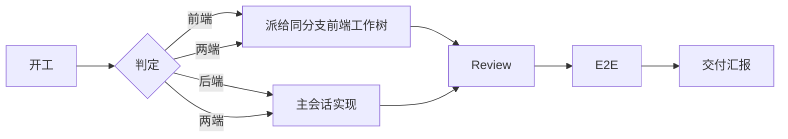

<div align="center">

# Sumer

**多版本并行开发的分派、验收与自验证 skill**

[](https://claude.com/claude-code)
[](#当前状态)
[](#工作流)

在后端工作树做指挥，把前端交给同分支的前端工作树；review 由独立 subagent 执行；E2E 用 ego-lite 点一遍。

用于一个人同时推进「线上问题、提测验收、开发需求」三个版本。

</div>

---

## 为什么用 Sumer

版本迭代的共同要求是：**有效率，同时保证质量**。

日常开发通常会同时遇到三类场景：

| 场景 | 例子 | 关键要求 |
|---|---|---|
| 线上问题 / 技术支持 | 线上 v0.7.0 的 bug 排查 | 快、稳，不能引入新风险 |
| 提测版本产品验收 | v0.7.1 的验收问题 | 改动可控、可回归、可交付 |
| 开发分支需求 | v0.7.2 的新需求 | 能并行推进，不阻塞前两个 |

一个人同时处理三个版本，真正难的不是写代码，而是流程：

- 上下文串了：前后端代码、规范、状态混在一个会话里，模型判断越来越差。
- 前端派错工作树：派给了错误的分支，改完才发现不是同一个版本。
- review 只看后端：前端组件、Token、视觉规范没人检查。
- 修完 P0 后原始问题消失：汇报里只剩「已修复」，最初的问题没人记得。
- 服务已经在跑，却因为「需要授权」又停一遍、起一遍。
- 本地单测过了，界面却点不动：代码逻辑通，不等于功能可用。

Sumer 把这些固化成可重复的流程。

## 核心思路

### 1. 版本隔离

用 `git worktree` + `orca` 并行处理多个分支：一个版本一个工作树，互不覆盖。

### 2. 上下文隔离

某项需求涉及前后端时，把前端拆出去，保证前端内容不进入后端会话。

上下文是重要资源。一个会话只背一套代码、一套规范、一套状态，判断质量才稳定。

### 3. 契约先行

涉及两端时，先把路径、入参、响应字段、错误格式写进派活消息，不让两端各自猜。

### 4. 质量门禁

- 独立只读 review subagent，不主线自审、不 fork。
- 有前端改动必须做前端 review：规范、组件、Token、视觉一致性。
- E2E 用 ego-lite 真点一遍主路径，确认界面可交互、功能可用。

### 5. 自验证

不只是让模型写本地单测，而是给它一个可运行、可验证、可迭代的环境：

- 跑测试、看结果、定位失败、自己修。
- 用 E2E 验证真实交互，而不是只验证代码逻辑。
- 修完做针对性验证，再进入交付。

这样能削弱 human in the loop 的重复验证负担，让研发把精力放在拆解和设计更复杂、更核心的需求上。

### 6. 人在环上

人负责目标、方案、契约、验收标准和关键判断；Sumer 负责流程隔离、质量门禁和重复验证。

不是「AI 全自动」，而是「人从重复执行里退出来，站到更高一层」。

## 工作流



## 核心能力

| 能力 | 做法 |
|---|---|
| 角色判定 | 按工作树内容和消息来源判定，不依赖仓库名 |
| 前端派发 | 按会话 cwd 和分支定位到唯一前端工作树；只向它只读握手 |
| 上下文隔离 | 前端不进后端会话；一个会话只保留一套上下文 |
| 并行开发 | 用户明确要求时才开 agentteam，按文件所有权拆分 |
| 独立 review | 独立只读 subagent；有前端改动必须做前端 review |
| P0 口径 | 崩溃、数据、权限、契约、费用，以及违反 `AGENTS.md` / `docs/` 明确约束 |
| E2E | 固定 18001 / 15173；同分支服务已跑直接复用 |
| 自验证 | 模型在可运行环境里跑测试、看结果、迭代修复 |
| 汇报 | 三节简报；原始问题保留，修复后也不删除 |

## 以前 vs 现在

| 以前 | 现在 |
|---|---|
| 三个版本靠人切上下文 | 一个版本一个工作树，上下文隔离 |
| 前后端混在一个会话 | 前端派给同分支前端工作树 |
| review 靠主线自审 | 独立只读 subagent，只报 P0 |
| 本地单测过了就算完成 | E2E 真点主路径，确认界面可交互 |
| 修完 P0 原始问题消失 | 汇报保留原始问题与修复记录 |
| 服务重复启动、重复授权 | 同分支服务直接复用 |

## 当前状态

这是一个**开发过程中的实践验证**，不是成熟的团队平台。

- **已验证**：一个人同时推进三个版本时，worktree 并行、前后端上下文隔离、review + E2E 质量门禁能跑通。
- **使用范围**：目前主要作者在自己的日常开发中使用；已开源、可安装，正在团队内推广和迭代。
- **待验证**：团队多人使用后的协作成本、不同项目的适配性、效率提升的量化。
- **下一步**：先在小组内推广，收集反馈，再决定是否标准化。

## 安装

Claude Code 用户级 skill 目录：

```bash
git clone https://github.com/Kasuza-Haruki/Sumer.git ~/.claude/skills/Sumer
```

Windows PowerShell：

```powershell
git clone https://github.com/Kasuza-Haruki/Sumer.git "$env:USERPROFILE\.claude\skills\Sumer"
```

也可以手动把 `SKILL.md`、`references/`、`assets/` 放到 `~/.claude/skills/Sumer/`。

## 使用

**自动加载**：收到 `[dispatch:` 消息、涉及前端改动、要 review 或 E2E 时，agent 会加载本 skill。

**手动调用**：

```text
/Sumer
```

确认已加载：在 Claude Code 输入 `/skills`，列表里能看到 `Sumer`。

## 派活格式

```text
[dispatch:<branch>]
任务：...
验收：...
非目标：...
契约：<涉及接口时给路径、入参、响应字段、错误格式>
必读：先加载 Sumer skill，按执行方规则执行；AGENTS.md；docs/ 设计规范与本任务相关文档
约束：复用现有组件和 Token；规范不确定时提问，不自行加样式；不改无关文件；不 commit/push；Review 由指挥方统一做
回报：以 [fe-report] 开头，给分支、改动文件、git diff --stat、验证命令与结果、阻塞
```

## Review 口径

有前端改动时，review 必须包含前端清单：

1. 是否遵守 `AGENTS.md` 和 `docs/` 设计规范。
2. 是否复用现有组件和 Token，有没有自造样式或新增未约定值。
3. 规范缺失、冲突或不确定时，是否向用户提出，有没有自行决定。

违反任一项即为 P0。只报 P0、只修 P0、只跑一轮；P1+ 只报告。

## E2E

- 固定：后端 `18001`，前端 `15173`。
- 服务已在跑且两端分支相同：直接复用，不授权。
- 需要自己启动或连库：先授权。
- 只复用本分支的服务；其他分支报告冲突，不换端口、不停别人的进程。

## 汇报

三节：结论、Review 问题、未验证与阻塞。

Review 问题保留原始描述、状态、修复与验证。已修的 P0 也不删除，避免最初的问题在汇报里消失。

## 目录

```text
Sumer/
├── SKILL.md
├── references/
│   ├── frontend-dispatch.md
│   ├── review.md
│   ├── e2e.md
│   └── report.md
├── assets/
│   └── handoff-template.md
└── evals/
    └── evals.json
```

`references/` 和 `assets/` 按需加载；`evals/` 只用于测试，不进入模型上下文。

## 适用场景

- 前后端分仓，用同名分支或同名工作树并行开发。
- 后端会话做指挥方，前端在独立会话或 worktree 中执行。
- 需要固定 review 和 E2E 口径的团队工作流。
- 一个人同时处理线上问题、提测验收、开发需求三个版本。

## 不适用

- 纯问答、只读排查、状态查询。
- 没有前端配对仓库的单端项目。
- 只需要一次性的代码生成，不需要 review 和 E2E 的场合。

## 设计原则

1. 一个版本一个工作树。
2. 一个会话只背一套上下文。
3. 契约先行，不靠两端猜。
4. 只报 P0，只修 P0，只跑一轮。
5. 先验证再汇报，未执行就写未执行。
6. 原始问题不消失，修复后也保留。
7. 人负责目标和判断，AI 负责流程和重复验证。
